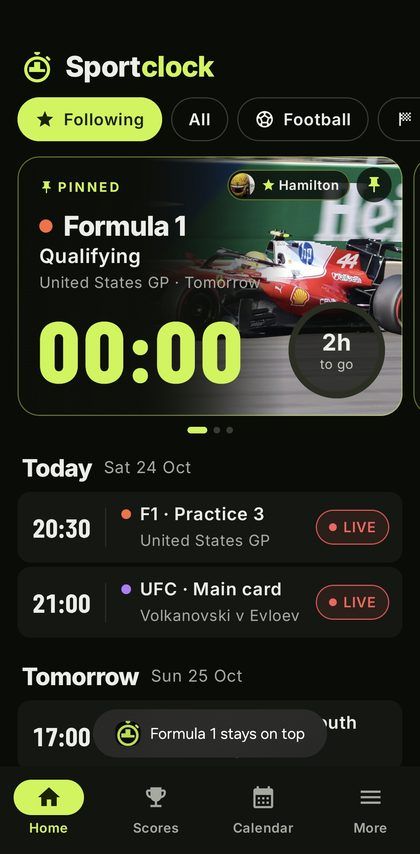
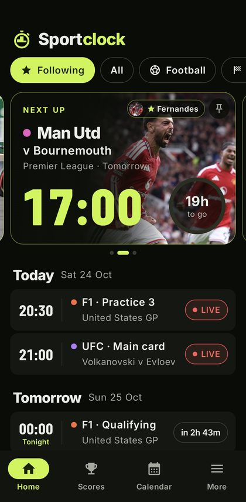
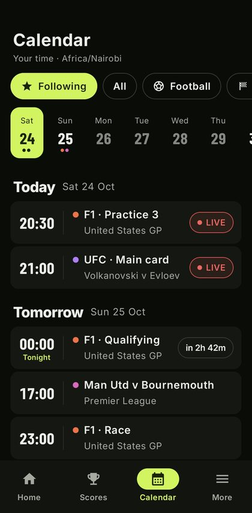
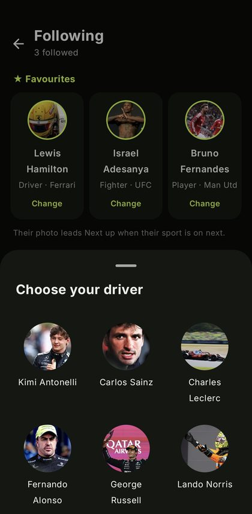
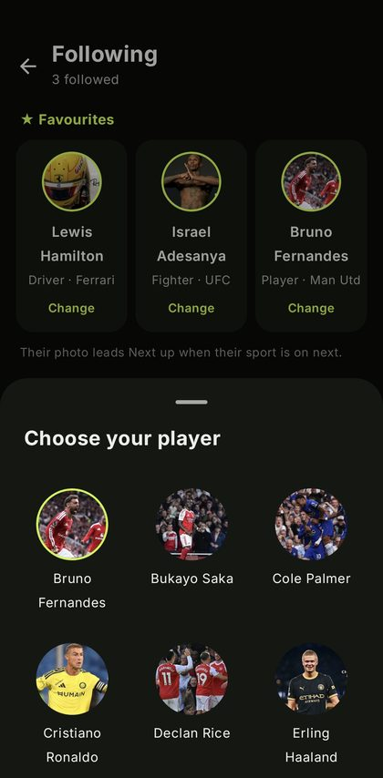
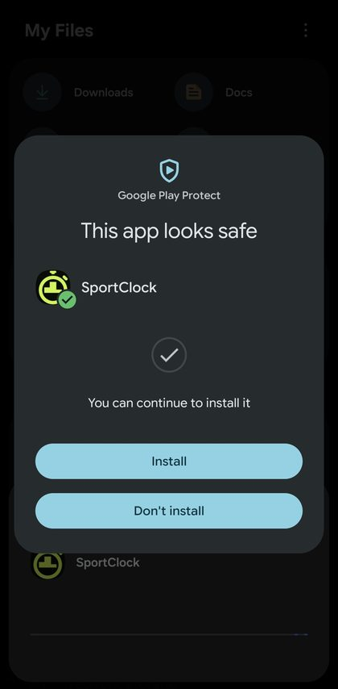

# SportClock (Android)

The native Android app for SportClock: when your sport is on, in your time.
It reads the same live data as the website ([sportclock.pages.dev](https://sportclock.pages.dev)), so fixtures update without a new APK.

**Private repository.** The app bundles press photos for personal use only; don't make this repo public or share the APK publicly.

## Screenshots

| Home: pinned F1 card | Home: swipe to Man Utd | Calendar |
|---|---|---|
|  |  |  |

| Favourites: choose your driver | Favourites: choose your player | Installing: Play Protect check |
|---|---|---|
|  |  |  |

## Install
1. Download the APK from the latest [Release](../../releases) and open it on the phone.
2. If Android asks, allow your browser or Files app to **install unknown apps** (a one-time setting).
3. **Google Play Protect scan:** if Play Protect is on (it is by default), the phone scans the APK before installing, because it doesn't come from the Play Store. Wait for the result. It should say **"This app looks safe"**; then tap **Install** (or **Update**). If it ever offers "Scan app" instead, tap it and wait.
4. Open SportClock.

It is signed with the same key as the earlier web-app version, so it updates in place without uninstalling. Android 8.0 or newer.

## Build
1. Double-click `build-release.cmd` (or run `.\build-release.cmd`).
2. Type the keystore password and the key password (hidden; never stored).
3. The signed APK appears as `SportClock-native.apk`.

Needs a 64-bit JDK 17 in `%USERPROFILE%\.jdks\jdk-17.0.20.1+1` and the Android SDK set in `local.properties`.
The keystore lives outside the repo (`../sportclock-android/android.keystore`) and is never committed.

## Where things are
- `app/src/main/java/app/sportclock/Model.kt`: events, series, time wording, status pills
- `Repo.kt`: data and scores fetching, follows, favourites, pin, and which NEXT UP cards show
- `Ui.kt`: hero card, pager, rows; `MainActivity.kt`: screens; `FollowScreen.kt`: Following and Favourites
- `widget/SportClockWidget.kt`: the home-screen widget
- `Photos.kt`: the bundled photo library (generated)

See [CHANGELOG.md](CHANGELOG.md) for what changed in each version.
